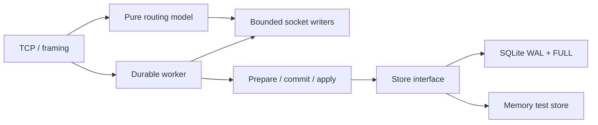

# Screech

[](https://github.com/codyps/screech/actions/workflows/ci.yml) · [Interactive benchmarks](https://codyps.github.io/screech/) · [CI and reproduction](docs/ci-benchmarks.md)

A standalone NATS server foundation in Rust, with deterministic routing and stream
models separated from transport and storage. This is experimental. It is **not yet
a complete nats-server replacement**, and the benchmarks do not establish a
performance or reliability advantage over NATS.

```sh
cargo build --release --locked
./target/release/screech-server --addr 127.0.0.1 --port 4222
# Experimental durable streams; the parent directory must already exist.
mkdir -p data
./target/release/screech-server --store data/screech.db
```

The binary prints `LISTEN host:port` after binding; `--port 0` selects an available
port. SIGINT/SIGTERM cancel connection waits and bound output/runtime shutdown,
including a wedged storage worker. `--storage-deadline-ms` bounds client storage
waits; a timeout leaves the commit outcome unknown. Optional
`--token` enables token authentication. This server has no TLS or account isolation;
the default listen address is loopback.

## Compatibility

| Area | Implemented |
| --- | --- |
| TCP Core protocol | INFO, CONNECT, PUB/HPUB, MSG/HMSG, SUB, UNSUB, PING/PONG, verbose +OK, -ERR |
| Routing | Literal subjects, whole-token `*`/`>`, queues, echo control, total-count auto-unsubscribe, reply subjects, header preservation, 503 no responders |
| Limits | Control-line/payload sizes, pending bytes and frame count, connection/subscription counts, write deadline, heartbeats, token auth timeout |
| Durable stream API (`--store`) | Stream create/info/list/names/update/delete/purge, message lookup/delete, publish acknowledgements and conditional publication |
| Consumers | Durable pull/push, queue push, filters and delivery policies, ACK/ACK-All/NAK/progress/TERM/ACK-and-next, backoff, delivery limits and advisories, selected live configuration updates |
| Retention and deduplication | Limits/interest/workqueue, count/byte/per-subject/age limits, discard old/new, persistent `Nats-Msg-Id` windows |
| Storage | SQLite WAL FULL, atomic state checkpoints/log reclamation, corruption checks and generation fencing |
| Remaining | Clustering, TLS/NKey/JWT/accounts, WebSockets, replay-original/advanced flow control and priority consumers, KV/object stores, per-message TTL/rollup, online backup/restore, monitoring/configuration reload |

`INFO.jetstream=true` with `--store` announces this experimental subset. Unsupported
configuration returns errors; this is not complete JetStream compatibility. Core
`+OK` and `PONG` are protocol responses, **not durable publication acknowledgements**.

## Boundaries



- `core::Core`: synchronous routing decisions. No sockets, tasks, clocks or storage.
  Delivery selection and enqueue happen under one adapter lock. UNSUB does not
  invalidate frames already accepted by a recipient's writer.
- `durable::State`: prepare/apply transitions over typed events. `Engine<S>` commits
  an event through a `Store` before making it visible or returning success.
- `storage::Store`: replaceable append-log interface. `MemoryStore` simulates it for
  fast tests. `SqliteStore` uses SQLite WAL + FULL synchronization and an exclusive
  ownership lock. It is independent of NATS' on-disk formats.
- `server`: bounded TCP ingress/egress and heartbeats. Writers never hold the
  routing lock. `jetstream::Handle` owns a separate bounded blocking storage worker.

The SQLite event log orders stream and consumer lifecycle, publications, delivery
reservations, ACKs and retention changes. Reservations commit before delivery;
confirmed ACKs commit together with retention deletion before replying. Up to 64
delivery reservations share one atomic event. Already queued plain ACKs (across
connections) share a commit, without waiting to assemble a batch or crossing a
non-ACK request. No delivery or confirmation is emitted before its batch commits.
A one-message `+NXT` request can commit its ACK, retention deletion and next
reservation atomically, then return the next delivery. Separate fetch/ACK requests
keep their separate commit boundaries. Immutable
stream/consumer generations fence stale ACKs after delete/recreate. The deterministic
model accepts explicit time; the adapter uses monotonic elapsed time anchored to
persisted/system time. Ambiguous storage errors poison the engine until recovery.

Atomic binary checkpoints cover live message metadata, sequence high-water marks,
consumer floors/pending sets and deduplication windows. They replace covered log
entries in one FULL transaction, automatically after 8192 events or 8 MiB of event-log bytes.
Startup validates snapshot/record checksums, versions, continuity and model invariants.
Known missing/empty databases fail closed. Recovery rejects unsupported record
and snapshot versions.

Keep the `.db`, `-wal`, `-shm` (when present) and `.db.lock` files together. Use local storage with
working locks and flushes. Removing a live WAL or copying only the database is not
a backup. Checkpoints reclaim log rows; SQLite reuses free pages and its file retains
a high-water size. This is not secure deletion.

File-backed JetStream keeps retained headers and payloads in SQLite, separate from
the event log. The model holds content references and byte lengths; GET and consumer
delivery load only selected bodies. Content and publish transitions commit together
in one FULL transaction. Checkpoints contain metadata and atomically reclaim bodies
that retention, purge or deletion removed. Recovery imports older inline checkpoints
before serving. SQLite uses an 8 MiB page-cache target, file-backed temporary tables
and no database mmap. Delivery selection loads at most 64 messages / 8 MiB per batch;
individual messages, staged groups and output queues can add bounded transient memory.

Memory still scales with message count: subjects, sequence indexes, consumer pending
sets, deduplication windows and checkpoint metadata remain resident. Large populations
of tiny messages or unique subjects need configured limits. Paging those indexes and
online backup/restore remain future work. Startup validates content references without
loading all bodies; body checksums are verified on read and a failure stops JetStream
processing. Losing a valid WAL suffix is not guaranteed detectable without an external
witness.

## Validation and further work

```sh
cargo test --locked
cargo clippy --locked --all-targets --all-features -- -D warnings
cargo build --locked --features fault-injection
python3 scripts/crash_tests.py target/debug/screech-server
python3 scripts/consumer_crash_tests.py target/debug/screech-server
python3 scripts/batch_crash_tests.py target/debug/screech-server
```

Fault hooks exist only with `fault-injection`. See [testing](docs/testing.md) for
process/VM fault schedules and benchmark reproduction. The default release build
has no environment-controlled failpoints.

- [Clustering proposal and acceptance gates](docs/clustering.md)
- [Benchmark dashboard](https://codyps.github.io/screech/)

## SQLite storage tuning

The store retains exclusive SQLite ownership, reuses its WAL allocation after an
atomic state checkpoint, and caches its next append position. The persisted
high-water update must match that cached position in the same transaction; success
advances the cache only after commit. WAL + FULL remains required and verified.
SQLite RESTART checkpoints synchronize the database before the WAL can be reused.

Automatic WAL checkpointing is set to 4096 pages. An 8 MiB journal-size target limits
retained allocation at WAL reuse; it is not a hard peak quota. Large transactions or
snapshots can exceed it. Application checkpoints remain at 8192 events / 8 MiB of
event-log bytes (excluding external content). Inspect or copy the database only with the server stopped or through a
future supported backup interface; SQLite ownership is exclusive while serving.
See docs/testing.md for real write/sync failure injection and recovery coverage.

## Concurrent durable requests

Already queued publications, pull requests and ACKs can share one SQLite FULL
transaction across streams/consumers. The worker prepares against a private model,
including deduplication, conditional publish checks and retention, then atomically
appends the resulting ordered records. It replaces committed state and releases
JetStream replies/deliveries only after success. Pending pulls and interested push consumers
can join the publications/ACKs that make them eligible. Reads and catalog changes
fence groups. No batch-assembly timer or client extension is required.

Groups gather at most 32 queued requests / 1 MiB of input. Staged outputs share the
existing channel capacity and an 8 MiB soft payload budget. Very large requests or
object names use the individual path. The planner shares persistent ordered indexes
and copies changed tree paths, keeping speculative state separate from committed
state. Small catalogs still clone. See [group commits](docs/group-commits.md).

## Unsafe consumer ACK durability

`--unsafe-ack-durability` requires `--store` and prints a startup warning. It allows
consumer reservations and ACK confirmations before their records reach durable
storage. A process or host failure can roll back pending deliveries, ACK floors and
retention effects; acknowledged workqueue messages can redeliver. The default keeps
reservations and confirmed ACKs strictly durable.

The opt-in mode buffers at most 1024 event records / 1 MiB, with a 50 ms flush target.
A slow or stalled disk can exceed that interval. Publication ACKs, catalog changes
and checkpoints remain FULL: they atomically persist the earlier buffered prefix
along with their own records. Graceful shutdown attempts a final flush. A flush
failure stops subsequent JetStream success. Buffered events share a checksummed
journal block while retaining their logical sequence numbers. The first block
commit upgrades the SQLite store metadata to version 2; current binaries read both
versions, and unsupported versions fail closed. After a confirmed buffered ACK,
the worker polls for at most 64 µs before sleeping, trading CPU for lower Fetch(1)
round-trip latency. Strict mode does not poll. This mode makes consumer performance
comparisons with NATS's buffered consumer state more useful; the guarantees are
still not identical. Benchmark series label it **UNSAFE ACK durability** separately.

## Core forwarding and JetStream completion

Live Core routing runs before storage admission/completion, even when a subject
matches a stream. Captured PUB/HPUB frames enter the durable worker in wire order,
while that publisher's reader can process later messages, subscriptions and PINGs.
JetStream publish ACKs, consumer deliveries and ACK confirmations still follow their
durable commits. A live Core subscriber can therefore see a message which is never
stored. Core +OK and PONG remain nondurable protocol responses.

Storage work and completion collection share a global 256-request admission budget.
Queued requests keep their slots even when the publisher disconnects or a wait is
cancelled. A full backlog or failed/timed-out storage completion closes the affected
publisher; decoupling does not create an unbounded queue. The storage deadline still
applies. Unrelated Core data bypasses the worker with a stable catalog. Pending stream
create/update/delete commands temporarily fence subsequent publication classification
so pipelined commands cannot miss a newly captured subject. Subject caches publish
before stream API replies. See docs/testing.md for deterministic stall tests.
