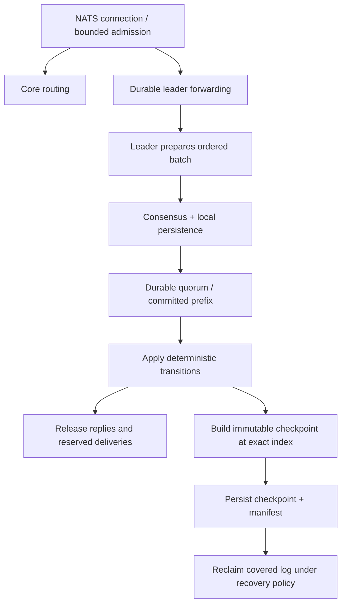

# Clustered durability: options and implementation plan

Re-reviewed November 2, 2026 against
`55180229d3d1333dde425d4370cead697e40ba7e`, including the storage, durable model,
worker, TCP output paths, tests and CI gates. The first review used `e9dd571`;
the intervening content-paging and unsafe-ACK changes materially change this plan.
The local NATS investigation is supporting evidence. The Raft replication and recovery
baseline is now implemented; the broader production gates remain this plan's scope.

## Implementation status: automatic formation and recovery

`--cluster-config` enables a separate consensus store and a real Raft 0.7.0 event
pump for three or five voters. Term/vote state and complete accepted entries persist
before protocol responses. Application indexes point into the committed entries;
they never give an accepted suffix application authority. Physical entry identity
includes term/index, so suffix replacement does not alias committed content.

Public nodes route client connections to the elected leader. The leader hands
its public sockets directly to the local protocol service; followers proxy over
TCP. Both local and proxied sockets share routing, admission limits and shutdown
when the leader epoch changes. The leader's
existing model owns stream/consumer decisions and Core interest. Quorum barriers
protect model reads; successful mutations follow quorum commitment. Leadership
changes close client connections and a replacement leader recovers its local
committed model. INFO advertises public reconnect endpoints. This deliberately
uses connection-level forwarding before distributed Core interest routing.

After a concurrent request group, the clustered worker allows up to 64 microseconds
for the next burst to reach the previous group's size. Requests already queued
still drain immediately, within the 32-request/1 MiB bounds. Catalog operations
remain FIFO fences. Sequential requests, idle workers and standalone stores do not
wait for a burst. Admission finishes before obtaining the group's quorum proof;
each successful response still follows that group's durable commit.

Fresh ReadIndex rounds initially probe a caught-up quorum. If it has not replied
after 250 microseconds, the actor sends the original context-bound probes to the
remaining voters. Completed reads and obsolete leader epochs discard these
retries; the ordinary heartbeat remains a further retry. All responses still
require a fresh quorum. Joint configurations and learners retain full fanout.
Bulk content reads and checkpoint hydration group references by accepted-entry
index, decoding each batch once while preserving output order and validating
every content identity. Only one decoded batch is retained at a time.
New accepted-journal allocations materialize their new extents with zeros, so
small subsequent commits can overwrite initialized storage. Existing bytes are
preserved. Allocation bytes supply no recovery evidence; complete accepted records
and the signed seal still synchronize before replication or client success.

The accepted journal's `SCSEAL05` seal pages also hold a bounded window of complete
accepted records, including their payloads and restart promises. Small acceptances
write one seal page and synchronize once. When a window fills, its records spill
past the published append prefix before the next seal is written; large records
use the append area directly. Logical record offsets and the authenticated hash
chain cover both locations. Both seal pages must authenticate, and recovery must
find the preceding seal's complete prefix in the current chain. A torn page or
missing spill fences the voter for automatic quorum repair.
`SCSEAL04` journals upgrade during ordinary appends, with mixed-version seal pages
accepted during the transition. Old readers reject the new seal version. The
independent complete SQL witness and FULL checkpoint-root installation remain
part of recovery validation.

The consensus owner starts a SQL snapshot on its first actual SQL read or write,
keeping validation and projection updates in one transaction. Turns that only
process cached Raft state or fresh ReadIndex probes need no SQL transaction.
ReadIndex checks the term of the accepted-journal promise installed after sync;
it still requires new context-bound quorum replies. Content reads retain an eager
SQL snapshot and their independent SQL epoch checks. All application completions
remain staged until the projection transaction, when present, commits.
Already queued same-term quorum replies, heartbeats and empty append messages
can complete that transaction after its time budget expires. New entries,
snapshots and new terms start a later turn. This lets follower commit updates
join the accepted-entry projection without waiting or exceeding the eight-input
batch limit.

Connected peer streams can send small authenticated frames directly with a
nonblocking socket write. A reserved slot in the same bounded writer queue owns
any partial frame's remainder; later messages wait behind it. Snapshots, large
frames, connection establishment and blocked sockets use the async writer. Each
replacement destination retains its own stream, and failed partial writes close
that stream before another frame can use it. This changes transport scheduling;
Raft's persistence and quorum requirements still govern message release.

One ordinary startup command handles formation, restart and repair; bootstrap and
join flags have been removed. Fresh original voters first persist an authenticated
formation certificate requiring all initial voters. Historical stores cannot form
a fresh genesis. Intact complete-cluster restarts resume their durable histories;
damaged stores wait for a live healthy quorum. A returning replica catches up through
a verified complete snapshot when its log is behind the compacted prefix, followed by the retained tail. Snapshot metadata/model, live
payloads, term/index, configuration and incarnation/tombstone state are installed
atomically before acknowledging the transfer. Covered log entries and unreachable
bodies are reclaimed in that same transaction; accepted suffixes remain intact.
Automatic checkpointing considers committed position, log bytes and configuration
changes. Transfer uses authenticated chunks and a full-image digest.

Configured node IDs and endpoints identify stable physical slots. Startup creates
fresh internal member IDs when a live quorum is reachable, including for intact
returning stores so consistent stale copies are never used for repair votes.
Damaged generations remain archived; a synced authenticated startup manifest selects
the new store. Startup automatically requests quorum-authorized enrollment of its
nonvoting incarnation. Promotion requires durable catch-up, then joint promotion/removal and an explicit leave-joint
entry. A new leader resumes committed replacement state. An abandoned learner can
be retired automatically before enrolling another candidate. Authenticated transport
hints let new learners reply to replacement leaders before receiving the committed
routing map in a snapshot. The accepted journal and recovery fence share one file
sync: complete entries, payloads and voting promises are durable together before
persistence-dependent messages escape. SQLite projects the journal between FULL
checkpoint roots. Startup replays lost projection writes before voting, while a
missing/damaged published journal prefix or unrelated checkpoint root requires
quorum repair. Both authenticated control records must validate; an older record
cannot silently replace a damaged newer promise. The FULL snapshot transaction
signs the exact predecessor journal tip so ordinary startup can finish a crash
between checkpoint installation and journal rotation. Legacy FULL stores upgrade
automatically. This replaces the initial two-sync SQLite-plus-fence path after
measurements identified its sequential write latency. ReadIndex replaces logged
read barriers, and persistence-independent leader replication overlaps local and
follower flushes. Even a single clustered pull stages its output: a committed
delivery reservation supplies its fresh quorum observation, while an empty or
error-only plan obtains a new ReadIndex before releasing replies. Requests can
join a group only before its consensus operation starts. Standalone scheduling
is unchanged. Commit notifications and query indexes persist asynchronously.
Clustered appends and ReadIndex requests dispatch directly to the Raft owner;
they do not make an extra round trip through the physical-storage executor.
Content/replay reads, snapshot serialization and checkpoint installation stay on
that executor. Checkpoint pressure uses verified in-memory counters as a
conservative hint; installation still checks the real committed SQL position and
preserves the accepted suffix. Recovery and corruption checks keep reading the
independent SQL witness directly.
On Linux, a separate worker queues dirty WAL data for writeback before page
checkpoints, reducing bursts of I/O that compete with the accepted journals.
The [writeback hint](https://man7.org/linux/man-pages/man2/sync_file_range.2.html)
provides no durability observation: every accepted-journal sync, SQLite checkpoint
ordering rule and FULL snapshot-root commit is retained. Unsupported filesystems
keep the normal sync path; observed I/O errors fence the voter. The worker pins
its generation's WAL descriptor and never follows replacement store paths.
Retired or wrong-incarnation senders
are fenced before voting; untrustworthy old state never bootstraps the replacement.
Committed leader removal explicitly steps down the old leader. Application writer
sessions also fence retiring workers across same-term configuration transitions,
and activation commits a barrier before reconstructing the new model.

General membership changes, sharding, standalone import, incremental snapshot I/O
and stronger distributed corruption repair remain future work. Complete transfer
images currently have a 512 MiB cap and materialize in memory; this has not certified
large-store tail latency or peak memory. See [operations and limits](cluster-operations.md).

Tests include real three/five-process failures, consumer ACK/dedup recovery, minority
refusal and full restart, plus the actual Raft/storage implementation under reversed,
duplicated and partitioned messages with conflicting accepted payloads. These are
correctness evidence for the initial crash model, not performance certification.
The recovery matrix additionally covers kills during snapshot transfer/activation,
missing/blank/corrupt/stale stores, missing committed tails and snapshot bodies,
incarnation/manifest loss, interrupted startup publication, interrupted joint apply,
loss of a replacement learner, and damaged minorities waiting for a returning quorum.
Every repair history uses ordinary startup at unchanged addresses, without a manual
membership operation. These
histories require a surviving healthy quorum; they do not claim recovery after all
authoritative copies are destroyed.

## Implementation status: single-voter storage executor

The opt-in `--single-voter --store <path>` driver implements the first part of
phase 1. Standalone startup and its unsafe-ACK option retain their existing behavior.
The new mode rejects unsafe buffering and storage backends that do not explicitly
promise durable atomic appends.

- `Engine::prepare_append` admits one private `GroupPlan` and returns an owned
  storage task containing its records, content and projection. The live model stays
  unchanged. The task can execute away from the engine; only its matching completion
  can advance durable/committed/applied positions and release outputs.
- The JetStream adapter uses a bounded storage executor and a bounded, ordered
  output adapter. It waits for one completion before handling more durable work;
  Core traffic and protocol heartbeats remain independent. Strict consumer events
  bypass the standalone consumer-buffering hook.
- `ExecutorStore` permanently owns the backend on a separate thread. Content
  reads, replay reads, appends, live-key enumeration, snapshot serialization,
  checkpoint installation, GC and WAL restart execute on that owner. Capability
  flags are captured before handoff. An opaque checkpoint job captures a private
  metadata root; its serialization and installation share the ordered I/O domain.
  Checkpoint success is reported only after installation completes. Shutdown joins
  the idle owner before releasing the server, ensuring its exclusive lock is gone.
- An ambiguous append or incorrect returned position quarantines the engine.
  Recovery of this fixed single-voter log treats complete durable appends as
  committed, including writes whose completion/reply was lost. Existing event and
  checkpoint formats remain readable by standalone mode.
- Engine and TCP tests cover delayed completion, retained content, failed writes,
  checkpoints, generated equivalence to standalone, ACK recovery and reply order.

The single-voter waiting adapter still serializes durable requests. The clustered
mode now has its own consensus pump, leadership lifecycle and accepted-suffix store.
Multiple outstanding application proposals, asynchronous physical storage for the
consensus pump and a fuller network/disk fault simulator remain. Single-voter
proposal task identity is local to an engine lifetime; it is not a Raft entry ID.
The current `(generation, sequence)` content identity remains valid only because
this mode never persists a replaceable uncommitted suffix. Background checkpoints
and concurrent GC are not enabled.

Validation for this increment: the full Rust regression suite passed, as did the
strict-mode engine/TCP tests, formatting and Clippy with and without all features.
The existing `crash_tests.py` and `consumer_crash_tests.py` suites also passed
**38 process-fault scenarios** using a launcher that adds `--single-voter` to every
server invocation. This covers publication/ACK boundaries, checkpoint interruption,
dedup recovery and bounded shutdown during a hung append. These are process-failure
tests; host power-loss and clustered fault testing remain separate gates.

## Recommendation

Rework the durable engine around **one authoritative replicated history, including
its referenced content, and one recovery protocol**. Preserve the deterministic
stream/consumer model, paged SQLite content, persistent indexes, parser and Core
routing. The default mode equates local append success with application commitment;
the unsafe mode even allows visible consumer state ahead of durable storage.
Neither boundary is consensus commitment. Wrapping `Store::append` would miss
content writes, consumer buffering, checkpoints, read failures and output release.

Start with a three-voter, single-group Raft implementation, using SQLite FULL as
the local persistence backend and the replicated log as the application redo log.
Keep content in the same transaction domain; do not re-inline retained bodies into
the model or duplicate them into a second application log. Reject
`--unsafe-ack-durability` in the first clustered mode, including single-voter mode
of the new engine. Preserve the existing opt-in standalone behavior separately.
Use `raft-rs` as the first integration candidate, with OpenRaft as a comparison.
This is conditional on the simulation and persistence spike below, rather than a
claim that Raft is intrinsically safer or faster than Viewstamped Replication (VSR).

Treat a TigerBeetle-style VSR/storage design as a serious second candidate. It is
particularly attractive if the required contract includes repair across several
partially corrupted replicas, or continued low latency when the leader's disk
stalls. Prototype those specific differences before committing to custom consensus.
Ordinary Raft plus SQLite does not provide that fault model, and a change to VSR
alone would not provide it either.

The initial redesign should simplify ownership and durability boundaries. Payload
paging already exists, so it no longer justifies a custom storage engine by itself.
That decision now depends on repair requirements, resident metadata, snapshot/GC
pauses and measured write amplification. Rewriting the entire
server, switching languages, or adopting TigerBeetle's financial schema would not
help the initial clustering work.

## Contract and decision criteria

The default mode establishes strict local durability, bounded admission, and
separate Core/JetStream semantics. The explicit unsafe consumer mode has a weaker
contract. CI now targets at least **1.10x throughput and at most 0.90x p99** versus
NATS `always`, using three or more checked trials per case. It gates the unsafe-ACK
series and reports strict-default results separately; this is not a clustered SLO
or evidence of equal consumer durability. See the [target checker](../scripts/check_jetstream_targets.py)
and [CI workflow](../.github/workflows/ci.yml).

Absolute clustered throughput, latency, retained-data-size and recovery-time
targets remain unspecified. Use the following strict clustered contract; choose
deployment-specific budgets in phase 0 without substituting the unsafe CI target.

| Dimension | Required behavior | Evaluation |
| --- | --- | --- |
| Durability | Successful publication, metadata mutation and confirmed consumer ACK survive allowed failures. ACK progress and retention effects recover together. | Check payloads, consumer state and generations after faults, not just stream counts. |
| Consistency | Linearizable durable operations and reads; conditional publication and deduplication evaluated in the agreed order. | Independent history checker, including unknown outcomes and reads through each node. |
| Availability | Three voters progress with two connected, healthy voters; minority durable requests fail or time out. | Isolate any node, including the leader; distinguish quorum loss from slow storage. |
| Latency | No intentional batch wait at low load; bounded queues and maintenance work at high load. | End-to-end p50/p95/p99/p99.9 and observed maximum for publish, fetch, ACK and full consumer cycle. |
| Throughput | Batch persistence and pipeline replication without weakening sync semantics. | Messages/s and bytes/s with equal durability, retention, payload and concurrency. |
| Recoverability | Recover acknowledged state without interpreting damaged or incomplete metadata as deletion. | Snapshot/log boundary faults, repeated restart, replacement, full-cluster power loss and upgrades. |
| Operability | Bound memory, log growth, catch-up bandwidth and time degraded. | Sustained overload and recovery while serving foreground traffic. |

RPO is zero for acknowledged operations **within the stated fault model**, except
for intentional retention, purge and deletion. Replication does not protect against
all copies being destroyed, operator-authorized deletion, or the same software bug
on every replica. Independent backups and restore drills remain required.

### Two fault-model levels

**Initial release:** crashes, pauses, partitions, reordered/duplicated messages,
whole-cluster power loss with stable storage intact, and fail-stop storage errors.
Successful flushes must actually persist data. Detected corruption quarantines a
replica before it votes, serves durable reads, acknowledges replication, or makes
cleanup decisions. Replacement requires a healthy quorum. A healthy majority can
continue while a damaged minority is replaced.

**Stronger target:** latent corruption, torn/misdirected writes, lost writes that
reported success, and repair using surviving pieces distributed across replicas.
This requires additional durable evidence and protocol-aware recovery. Checksums
alone cannot detect rollback to an older, internally consistent database. Neither
SQLite integrity checks nor a generic Raft library establish this stronger claim.
Do not silently include these failures in the first release's guarantee.

Both levels assume correct execution and non-malicious peers; malicious replicas
or arbitrary memory corruption require a different model. mTLS establishes peer
identity, not Byzantine fault tolerance. After a reported I/O failure, retrying or
simply restarting a process does not establish that page cache and disk agree:
quarantine and rebuild through a validated recovery path. The
[fsync-failure study][fsync] is directly relevant to this boundary.

## What the current implementation gives us

| Code boundary | Useful property | Required change |
| --- | --- | --- |
| [`durable::State` / `Event`](../src/durable.rs) | Explicit time/generations; `StoredMessage` can hold a `ContentRef` instead of headers/body. | Preserve pure transitions while making hydration and replicated content identity explicit. |
| `GroupPlan`, `encode_transition`, `Engine::commit_group` | Separate staged records and content; reads can resolve uncommitted content within a private group. | Replicate both vectors atomically; track proposal dependencies and content across more than one outstanding group. |
| `Engine::recover` / `decode_snapshot` | Reads event v1/v2/v3, snapshot v2/v3, hydrates tail publications, validates live references and migrates inline bodies. | Accepted tails must not be applied as committed; cluster migration must not invoke serving/cleanup before recovery authorization. |
| [`SqliteStore::append_transaction`](../src/storage.rs) | Event records, retained content, buffered consumer prefix and high-water mark share a FULL transaction. | Preserve this atomicity with hard state, accepted-entry identity and a distinct durable frontier. |
| `append_consumer_state` / `last_sequence` | Unsafe mode buffers records; returned positions and model progress can precede disk persistence. | These methods are not a consensus durability API. Reject buffering in clustered mode; use explicit flush completions. |
| `checkpoint_with_content` | Atomically publishes metadata and deletes covered records/blocks and non-live content, then restarts the WAL. | Replace latest-state-only GC with prefix snapshots, pinned content and accepted-tail reachability. |
| [`Worker::fill`, `ack`, `group_requests`](../src/jetstream.rs) | Selected bodies are read before reservation/ACK-and-next commitment; output is staged for groups. | Add asynchronous content preparation, leader-only scheduling and proposal-owned pull/output changes. |
| `Handle::attach_output` / [`Peer::enqueue_with_wakes`](../src/server.rs) | Committed output can route synchronously into connection queues; small idle protocol replies may write directly to the socket. | Fence before dispatch; isolate routing/lock contention from consensus timing without dropping bounded output accounting. |

File-backed publication records now use `$SCREECH.event.v3`: content references
are in the log, headers/body in `retained_content`, and both commit atomically.
`ContentKey` is `(generation, sequence)`; `ContentRef` contains lengths but no
expected digest. The row has a CRC covering its identity and data. MemoryStore
still uses inline content, so tests and simulation must exercise both layouts.

Snapshots are version-3 metadata images, not self-contained payload backups.
Startup checks the existence, subject and lengths of checkpointed content; it does
not checksum every checkpointed body. Body reads verify CRCs and poison the engine
on failure. Tail publication replay does hydrate/check bodies before applying them.
The test `missing_checkpoint_content_blocks_recovery_and_corruption_poisons_reads`
deliberately distinguishes missing content from same-length corruption discovered
later. Successful startup therefore does not certify all retained bytes.

Checkpoints still run in the commit path at **8,192 records or 8 MiB of event-log
bytes**, excluding external content. They serialize resident metadata, enumerate
live keys, delete dead content and perform WAL RESTART. Payload memory is now
bounded by selected/staged/output bodies rather than the retained byte total;
metadata still scales with messages, subjects, consumers and dedup state. Delivery
batches target 64 messages / 8 MiB, with a single oversized message possible.

The local layout is a good starting point for the NATS concern: physical separation
already exists, but one transaction ties content to its event. The missing cluster
contracts are complete entry replication, conflict-safe content identity, snapshot
content transfer, GC roots, and durable-versus-visible positions.

Most business logic can remain. The engine/worker boundary and recovery format
need substantial changes. Existing standalone fault tests are useful but do not
establish distributed safety. See [group commits](group-commits.md),
[testing](testing.md), and [benchmark methodology](ci-benchmarks.md).

### Evidence from this re-review

Ran the library tests and the `storage`, `storage_content`, `durable_model` and
`durable_content` integration suites with all features enabled: **83 passed**.

```sh
cargo test --locked --all-features --lib \
  --test storage --test storage_content --test durable_model --test durable_content
```

The [content tests](../tests/durable_content.rs) cover external/inline model
equivalence, staged reads, checkpoint references, read-time corruption, generation
reclamation and unsafe suffix recovery. The [storage tests](../tests/storage_content.rs)
cover atomic event/content persistence and ordered batch reads. Library tests also
cover legacy migration, packed consumer records and direct output ordering.
These validate the local behavior used in this plan. Process/VM fault harnesses,
performance and memory benchmarks were inspected but not rerun for this re-review;
no distributed implementation or cluster performance has been validated.

## Lessons from TigerBeetle's presentations

I read the relevant published transcript sections and slide text, then checked
protocol claims against papers and implementation documentation. Historical talks
describe particular implementations; they are not a benchmark of Screech.

| Presentation/material examined | Relevant lesson | Consequence for Screech |
| --- | --- | --- |
| Joran Dirk Greef, [A New Era for Database Design with TigerBeetle][tb-era], 2023; fsync, WAL recovery and simulation sections. | Storage faults can invalidate consensus assumptions. Damaged committed records must not be mistaken for a torn, uncommitted tail. | Specify recovery alongside replication; inject disk faults as well as crashes. |
| Joran Greef, [Redesigning OLTP for a New Order of Magnitude][tb-oltp], 2024; batching, storage and consensus sections. | Share the logical consensus/application log, batch work, overlap I/O, and use replication during recovery. Deterministic physical storage enables fine-grained repair. | Keep one redo history; measure copying, snapshotting and payload movement before sharding. |
| Tobias Ziegler, [The Tale of Taming TigerBeetle's Tail Latency][tb-tail]; speaker's slides published by conference organizer ScyllaDB. | Better asymptotic complexity alone did little for the measured tail; CPU layout and incremental work mattered. | Bound expiration, serialization, index maintenance and catch-up work, not just network queues. |
| [Durability and the Art of Consensus][tb-consensus], SD'24. | The team's [accompanying summary][tb-summary] frames availability as using durable redundancy effectively. | Evaluate whether surviving data can actually participate in recovery, not just replica count. |

The SD'24 video could not be fetched here; that row uses the team's written summary,
not a claimed viewing or full transcript review. The other rows use accessible
presentation content. The tail-latency deck includes unfinished measurement
placeholders, so it informs technique rather than quantitative sizing.

TigerBeetle's [architecture description][tb-architecture] documents six replicas
with a replication quorum of three and view-change quorum of four, concurrent local
persistence and replication, and recovery that distinguishes corrupt/missing data
from records known never to have been accepted. Physically deterministic storage
and hash references support repair. These are integrated system features, not
guarantees inherited from the VSR paper.

The independent [Jepsen TigerBeetle report][tb-jepsen] found unusually strong
corruption resilience, but also crashes and latency problems in the tested
versions. Its version-specific results support investment in fault modeling and
testing, not an assumption of reliability from protocol choice.

Screech has arbitrary message bodies, independent streams, wildcard routing,
push/pull consumers and expiring retention. TigerBeetle's fixed-size financial
transactions and batch benchmarks cannot be translated into Screech messages/s.
Retained payload bytes may force a storage redesign before consensus CPU saturates.

## Protocol options

With an established leader, durable Raft, durable VSR and Multi-Paxos can all use
one replication round trip per batch, with pipelining. None inherently requires a
second application fsync per operation. The important differences here are recovery,
election/view change, implementation control and maintenance cost.

| Option | Durability and recovery | Throughput and latency | Reliability and fit |
| --- | --- | --- | --- |
| **Raft** | Stable term/vote/log requirements; snapshots preserve a committed prefix. Standard protocol assumes stable storage, not arbitrary corruption repair. | Batched, pipelined leader replication. Conservative integration waits for leader disk and sufficient followers. | Best initial candidate because we can reuse a Rust implementation and retain clear ordering. Integration remains our responsibility. |
| **Durable VSR** | View changes and recovery transfer provide a useful basis for storage-aware repair. The 2012 diskless variant does not meet our whole-cluster power-loss contract. | Similar healthy-path cost. Predetermined primary selection avoids vote races but can cycle through unavailable primaries. TigerBeetle's extensions improve slow-storage behavior. | Strong alternative; building and maintaining durable recovery and reconfiguration is significant work. |
| **Multi-Paxos** | Persist promises and accepted values; recover accepted values from a quorum. Agreement is not a complete broker recovery design. | Stable-leader phase 2 takes one round trip; batching/pipelining work. Two phases need not run for every operation. | No demonstrated advantage here that pays for assembling the remaining system. |
| **Flexible Paxos / flexible VSR** | Cross-phase quorum intersection remains essential; smaller write quorums require different recovery quorums. | Can avoid slow replicas on writes, trading against election/recovery availability. | Revisit for topology and slow-fault requirements; do not shrink quorums in an unchanged Raft library. |
| **EPaxos / generalized consensus** | Dependency ordering needs correct conflict detection and recovery. | Can reduce WAN leader detours for independent operations; conflicts add cost. | Stream sequences, dedup, limits, ACK floors and retention conflict frequently. Poor initial fit. |
| **Chain replication** | Updates traverse a chain; safe reconfiguration needs a reliable membership authority. | Spreads forwarding bandwidth and pipelines well, but writes traverse the chain and slow members affect it until reconfiguration. | Revisit for large immutable payloads; weaker fit for low-tail consumer/metadata operations and simple failover. |
| **Zab / atomic broadcast** | Leader activation, total ordering and durable quorum ACKs provide a comparable foundation. | Pipelined leader-based ordering; no evident workload-specific advantage. | Valid family, without a concrete reason to prefer another implementation over the Rust candidates. |
| **External replicated database/log** | Can outsource consensus if all authoritative effects and replay positions belong to its recovery/transaction contract. | Extra service hops, serialization and operational dependencies. | Consider if a separate database is acceptable. Leadership in etcd plus independent message files does not solve durability. |
| **Async primary/backup, CRDTs, gossip** | Async failover can lose acknowledged writes; eventual merging cannot enforce our ordered sequence/CAS/ACK contract. | Favors local latency or partition availability. | Useful for telemetry or explicitly weaker regional copies, not the authoritative durable path. |

References: [Raft][raft-paper], [VSR Revisited][vr], [Paxos Made Simple][paxos],
[Flexible Paxos][flexible], [EPaxos][epaxos], [Chain Replication][chain], and
[ZooKeeper internals][zab]. Workload-fit judgments are this proposal's assessment.

The VSR distinction worth testing is how a new primary obtains the right history.
Raft restricts elections using candidates' log freshness. VSR chooses a primary
from the view number and has it reconstruct the safe history from view-change
messages before serving. This is useful for integrating repair, but choosing the
next primary is not enough: collecting the correct history and preserving accepted
operations are the difficult parts. Neither basic protocol alone repairs arbitrary
disk corruption. [VSR recovery and view changes][vr].

Multi-Paxos separates these responsibilities differently: a new leader establishes
its ballot and recovers accepted values, then pipelines new slots. That flexibility
is useful if we need unusual quorums or ordering, but Screech would still own log
holes, snapshots, membership, retries and application recovery. For this workload,
those additional choices offer no established simplification. [Paxos state-machine
construction][paxos].

### Quorums and placement

Start with three full data-bearing voters in three independent failure domains.
A metadata-only witness is not a durable payload copy. Five voters give two-node
failure tolerance with a three-voter quorum, at additional storage/network cost.
Survival of acknowledged data and the ability to resume writes are different:
a surviving copy does not automatically authorize forming a new quorum.

For six-node flexible quorums, `write = 3`, `view-change = 4` intersect because
`3 + 4 > 6`. Three available nodes may continue with an existing primary but cannot
necessarily replace it. With two nodes per domain, one domain loss leaves four;
another node loss can prevent failover. Do not call that unconditional tolerance
of three failures. [Flexible-quorum basis][flexible], [TigerBeetle layout][tb-architecture].

Cross-region synchronous durability includes WAN latency in writes. Keep the first
cluster regional. Async disaster recovery needs an explicit nonzero RPO; a stronger
regional-loss contract pays the synchronous WAN cost. Evaluate every allowed quorum
against placement: spreading machines is insufficient if a valid write quorum can
fit inside one failure domain.

## The NATS lesson: ownership and recovery boundaries

Separate files for consensus and materialized state are normal and can be safe.
The danger is independent authorities, early replies, premature log reclamation,
or recovery decisions made from incomplete state.

The [Jepsen NATS 2.12.1 investigation][nats-jepsen] provides historical examples:
older snapshots could erase stream creation in an earlier version; minority
snapshot corruption could cause orphan cleanup and stream deletion; deferred
fsync could produce acknowledged-write loss and persistent divergence. The report
distinguishes earlier fixed bugs from findings open when published. This review
does not assert their status in today's NATS or claim one root cause for all of them.

The local [confirmed-ACK investigation](nats-ack-durability.md) is narrower:
standalone NATS confirmed ACKs before consumer-state file installation, including
with `sync_interval: always`. Its pinned reproduction demonstrates that persistence
boundary, not clustered Raft correctness. It was read, not rerun for this review.

Make these explicit Screech invariants:

1. An entry contains every authoritative effect, including payload or a provably
   durable payload reference, consumer state, retention, dedup and generations.
2. Application may lag replication, but its effects remain recoverable from the
   log until a durable checkpoint covers them.
3. Snapshots identify an exact committed prefix and its membership/generations.
   Older snapshots cannot roll back state or resurrect deleted objects.
4. Missing/corrupt metadata means unknown state, never an empty catalog. Cleanup
   follows committed deletion and recovery-safe garbage collection.
5. Durable replies and deliveries follow commitment and application of their
   operation. Background flushing is not that boundary.
6. Lost files cannot reset voting state or node identity. Blank replacements join
   as learners with new identities under a valid membership change.

## NATS failure review against the implementation (November 2, 2026)

This follow-up examines the implemented storage, Raft pump, startup supervisor and
application adapter, rather than relying on the design above. It reads upstream
issue reports, the relevant merged patches and their tests, including the
[2.12.6 release fixes](https://github.com/nats-io/nats-server/releases/tag/v2.12.6).
Reports describe particular versions and schedules; a matching symptom does not
establish that different systems share a root cause. An issue title containing
“FIXED” is not evidence that its proposed patch was merged.

The review reproduced and fixed two gaps in Screech:

- Missing content referenced by the committed model returned `None` from the
  cluster adapter. The engine stopped serving durable work, but the Raft actor kept
  heartbeating, preventing healthy replicas from taking over. Single and batch
  content resolution now report missing references inside the epoch-checked
  database operation, quarantining the replica. Recovery reference validation also
  checks subject and lengths there. Structurally invalid application recovery now
  fences the current replica; stale epochs and network timeouts do not quarantine
  otherwise healthy storage.
- Startup verified stored snapshot byte digests and payloads without checking the
  application model before constructing Raft. A malformed model with intact file
  digests could therefore become a voter. Startup now validates the complete model,
  required content set and membership before enabling the actor. The fixed-size
  group also explicitly requires the configured number of distinct nonzero voters
  on snapshot installation, membership replay and configuration application. A
  malformed configuration cannot silently reduce the required quorum to one.

Both gaps have failing-before/passing-after regressions. The tests distinguish byte
corruption from structurally invalid data whose envelope checksums still match.

| Upstream failure class and primary sources | Screech boundary and regression evidence |
| --- | --- |
| Acknowledging writes without syncing; divergent replicas after an OS crash and pauses ([#7567](https://github.com/nats-io/nats-server/issues/7567)) | The accepted journal syncs complete entries, payloads and voting promises before persistence-dependent protocol messages. Process tests inject errors before and after its real sync; neither produces a publication success and the node heals from the quorum. Independent VM campaigns separately exercise power loss, torn writes and block I/O errors. |
| Standalone confirmed consumer ACK preceding state installation ([#8821](https://github.com/nats-io/nats-server/issues/8821)) | Strict consumer reservations, ACKs, retention and publication dedup are transitions in the authoritative log. The existing standalone consumer crash suite and strict-mode engine/TCP tests check confirmed ACK recovery. The new empty-checkpoint/full-cluster-kill history checks consumer ACK floors and dedup as well as payloads. The explicitly unsafe standalone ACK option retains its weaker contract. |
| Corrupt records skipped during enumeration ([#7549](https://github.com/nats-io/nats-server/issues/7549), [#8632](https://github.com/nats-io/nats-server/issues/8632)) | Entry CRCs and snapshot SHA-256 checks propagate failures. A missing required body is now also a replica fault, including in a batch. The new live-content tests require an error/disconnect, automatic fencing and recovery of both the first and subsequent messages; a damaged record is never treated as a successful empty read. |
| Minority snapshot corruption interpreted as an empty catalog and orphan cleanup ([#7556](https://github.com/nats-io/nats-server/issues/7556)) | One replicated group owns catalog, consumers and bodies; there is no orphan-directory cleanup driven by a separate metadata group. Startup validates the complete image before voting. Tests corrupt two of five voters, including the old leader, retain their damaged files, heal both and verify catalog, payloads and ACK floors. A separate test proves a checksum-valid malformed model waits without starting Raft. |
| Older/out-of-order snapshots erasing newly created streams ([#5700](https://github.com/nats-io/nats-server/pull/5700), [#5946](https://github.com/nats-io/nats-server/pull/5946)) | Snapshots are tied to a committed term/index and cannot move behind the current commit/base. Recovery replays the committed tail after the snapshot. New tests deliver an older empty snapshot after stream creation, and kill all processes immediately after acknowledged stream/consumer creation over an older empty checkpoint. |
| Stream update omitting existing consumers from an asynchronous metadata snapshot ([#7939](https://github.com/nats-io/nats-server/pull/7939), fixed in 2.12.6) | `State::apply_validated(Event::Update)` changes the stream configuration while retaining its consumer map. Checkpoint jobs capture a private persistent state root. A process history updates a stream with an ACKed and a pending delivery, checkpoints, restarts all voters and checks both consumer positions. |
| Snapshot decode error ignored while the applied index advanced ([#7944](https://github.com/nats-io/nats-server/pull/7944)) | The event pump returns on installation failure before releasing messages or calling advance. A malformed-image test checks durable commit/view, Raft applied position and the outbound queue. Structural application recovery errors now also cause replica fencing rather than endless service-recovery retries. |
| Committing prior-term entries by counting replicas ([#7955](https://github.com/nats-io/nats-server/pull/7955)) | Pinned raft-rs 0.7 requires the commit candidate's log term to match the current term. A five-voter test delivers actual persisted follower ACKs for an older-term majority while withholding the current-term entry: application state remains uncommitted until a current-term majority is persisted. |
| Persisting an incremented candidate term with a stale vote ([#7956](https://github.com/nats-io/nats-server/pull/7956)) | Raft supplies one HardState; the accepted journal persists its resulting term and vote together before vote requests escape. A campaign/restart regression checks the durable self-vote, term, outgoing vote requests and restored group size. |
| Membership replay collapsing cluster size to one ([#7850](https://github.com/nats-io/nats-server/pull/7850)) | Snapshot configuration and committed changes reconstruct membership before actor startup. Cardinality validation now enforces the unchanged configured voter count. Tests reject a checksum-valid singleton snapshot and restart a repaired voter alone after compaction: it cannot establish a serving leader. |
| Membership changes combined with partitions and kills losing acknowledged records ([#7545](https://github.com/nats-io/nats-server/issues/7545)) | Replacement enrolls a learner, waits for durable catch-up, then uses explicit joint promotion/removal and leave-joint; it does not shrink the quorum on timeout. Existing histories cover interrupted joint apply, lost learners, quorum refusal, stale writers and writes during repair. These are targeted schedules rather than exhaustive membership/partition exploration. |
| Consumer deletion/recreation colliding on a shared directory ([#8793](https://github.com/nats-io/nats-server/issues/8793)) | Consumers have committed generation identities, without independently created/deleted consumer-store directories. The new clustered history recreates the same name, submits an old ACK and checks the new consumer before and after a checkpoint and election. Existing model/standalone histories cover deletion, recreation and stale tokens. |
| Disk stalls leaving valid ACKs ignored indefinitely ([#8789](https://github.com/nats-io/nats-server/issues/8789)) | The new interposer history hangs an actual leader WAL sync during an ACK, checks that no confirmation escapes, elects a healthy leader, redelivers the pending message and confirms its original late ACK. Restarting the stalled process heals it without resurrecting the acknowledged payload. |
| Stream data and consumer offsets recovering to different histories ([#7693](https://github.com/nats-io/nats-server/issues/7693), [#8036](https://github.com/nats-io/nats-server/issues/8036)) | Stream/consumer state shares the same log and checkpoint. Model invariants reject consumer offsets ahead of the stream and inconsistent pending/history records. Recovery does not reset offsets to disguise lost messages. Existing crash histories plus the new full-restart/update tests check payload and consumer positions together. |
| Snapshot reading racing with deletion/retention ([#8820](https://github.com/nats-io/nats-server/pull/8820), closed without merge) | This report concerns streaming backup semantics, which are distinct from a Raft recovery snapshot. Screech constructs a complete image under the storage ordering/lock boundary from a captured model root, verifies every required body and transfers immutable bytes. Existing recovery tests purge and compact the donor while a receiver is paused mid-transfer, then verify the recovered state. |
| Shutdown/recovery errors deleting authoritative Raft storage ([#6061](https://github.com/nats-io/nats-server/pull/6061)) | Storage or service startup errors do not authorize deletion of a generation. The supervisor fences it and creates a fresh learner generation through the surviving quorum. Damaged-file, interrupted manifest/snapshot and learner-loss histories check this path; original generations remain available for diagnosis. |

Run the targeted process histories with:

```sh
cargo build --locked --features fault-injection
cc -shared -fPIC -O2 -Wall -Wextra -Werror -o sqlite-io-fault.so scripts/sqlite_io_fault.c -ldl
python3 scripts/cluster_nats_regression_tests.py target/debug/screech-server --shim ./sqlite-io-fault.so
```

CI runs this suite together with the full Rust, cluster recovery and standalone
fault suites. The new sync-failure selector in the test-only interposer preserves
its original standalone defaults.

The [Jepsen/LazyFS harness](../tools/jepsen/README.md) now adapts the upstream
NATS queue workload and loss/divergence checker to ordinary three/five-voter
Screech startup. Real LazyFS mounts cover each voter's database, WAL, watermark,
manifest and recovery generations. Every mount must demonstrate loss of unsynced
bytes and preservation of fsynced bytes; every injected cache clear must receive
its completion acknowledgement. Histories cover majority/all-voter cache loss,
overlapping quorums with pauses, partitions plus kills, bit flips, truncation and
complete voter-state deletion. Final checks require all local manifest identities
to be current voters and persisted application positions to converge. Required
faults and nonzero acknowledged writes prevent vacuous passes. The recorded
three/five-voter campaigns passed all twelve histories, retaining all 4,016
acknowledged publications. See the harness README for setup, commands, artifacts
and the exact checked contract.

The consumer workload now records confirmed ACKs and partial cycle completions,
then audits every public node after the same faults. Its fixtures check retained
limits data and durable ACK floors, interest deletion only after both consumers
ACK, workqueue deletion, pending reservations, consumer deletion/recreation,
fencing of the old ACK token and deduplication of both retained and already-deleted
messages. A later timeout cannot discard earlier confirmations or successful reads.
The checker can also be replayed against saved histories without running servers.
The recorded three/five-voter consumer campaigns passed all twelve histories and
all 435 confirmed ACK obligations, then passed replay against the final checker.

The independent-VM runner now gives every voter a separate kernel, RAM and ext4
block image. Its power nemesis pauses all targets and sends every QEMU SIGKILL
before waiting for any exit. Cold-boot controls require new kernel IDs, preserved
fsynced bytes and lost unsynced overwrites. Disk faults change both the database
and its WAL, or erase whole stores/replace minority volumes, while retaining a
healthy quorum. Maintenance boots only inject the faults; ordinary server starts
must recover the confirmed consumer state and complete voter replacement.
The completed three/five-voter native matrices passed all ten histories, preserving
282 confirmed ACK responses across 28 grouped power cuts and 18 injected
damaged-voter replacements. Both saved campaigns also passed checker replay.

The active-I/O extension adds an NBD device under each guest filesystem. It holds
real writes/flushes without a reply, persists only part of a database/WAL block
request, or returns EIO to the guest. These cuts keep a fully admitted quorum's
machines and durable disks running and stop QEMU without draining the pending I/O.
Client request IDs, cold disk hashes, kernel errors, membership and fresh recovery
lifecycles make the fault boundary and recovery obligations explicit. Correctly
completed flushes on the surviving quorum remain durable in this model.
The final three/five-voter active-I/O matrices passed all ten histories, preserving
1,087 confirmed ACK responses across held writes/flushes, torn writes and write/flush
EIO. Two volatile-device majority/all-voter cold-power cross-checks also passed,
preserving another 40 confirmed ACKs. All twelve histories passed replay, including
their fault controls and automatic-recovery checks; the harness README records the
exact schedules, counts and scope.

The mixed extension retains directed Ethernet loss across minority reboots and
disk repair. Real UDP controls prove both blocked and permitted directions. A
shared conditional-write witness probes each leader-local service, rejects
conflicting confirmations and stale reads, and requires fresh minority catalog
mutations to remain unconfirmed. Surviving-majority progress is required during
partition, power-off, damaged restart and healing; normal startup must restore full
membership and preserve confirmed consumer ACKs and witness payloads.
The completed three/five-voter mixed matrices passed all twelve histories and
replays: 644 confirmed consumer ACKs, 173 conditional-write confirmations, 48
consumer audits and 48 witness audits. No conflicting confirmations, stale reads
or minority catalog confirmations were observed. All eighteen damaged voter
instances recovered automatically to full membership with a surviving quorum.

The assurance limits remain explicit. A healthy surviving quorum is required for
repair; a consistent rollback of all local files including the watermark cannot be
diagnosed locally. This review does not certify arbitrary storage/controller faults,
or all network schedules. The existing guest-power-loss job exercises standalone
mode. The LazyFS runner shares one guest kernel; the native runner uses separate
voter kernels and disks on one physical host. Physical-host/controller failures
and broader consumer-option/catalog workloads remain production gates. The current snapshot transfer size/memory limits and
serialized SQLite I/O still apply; these correctness histories are not throughput
or tail-latency benchmarks. MQTT, leafnodes, gateways, JWT permission rules and other
unimplemented NATS facilities are outside this durability review.

## Proposed engine and storage design



### Replicated unit and state ownership

Initially use one versioned `CommandBatch` per consensus entry: the ordered prepared
transitions **plus their content**, with explicit times/generations. Do not ship
only `GroupPlan.records`: v3 publication records have empty payloads and require
`GroupPlan.contents` to replay. Define one canonical envelope for the full batch
and its digest. The local representation can factor bytes into `retained_content`
instead of writing them twice, provided the log reader can reconstruct the exact
entry and its content survives until safe reclamation. Replication success follows
durable persistence of that complete entry, never just its metadata.

Followers hydrate the publication input for deterministic validation/apply and
then detach content into the reference model, as recovery does today. Decoding
metadata-only events and calling `State::apply` is not sufficient. Keep
versioned encoding/decoding shared by local persistence, peer replication, replay
and snapshots. Leaders evaluate against the preceding proposed prefix; followers
apply in the same order. Do not replicate SQL or SQLite WAL offsets.

### Content identity under conflict replacement

The current `(stream generation, sequence)` key is safe for today's append-only
committed history, but not sufficient to identify accepted proposals. Example:
leader A durably accepts an uncommitted publication at stream sequence 7; a new
leader replaces that suffix with different bytes at sequence 7. The old key would
collide or resolve the replacement to the wrong bytes. Speculative stream creation
can similarly reuse a generation after its suffix is discarded.

Give content an immutable publication identity, for example
`(cluster/group, term, log index, event ordinal)`, and bind its subject, lengths and
bytes with an expected digest in the entry/snapshot reference. Keep stream
generation/sequence as the application lookup key, pointing to this identity.
Imported checkpoint content needs an equally unambiguous import namespace.
Retrying the same replicated entry is idempotent only if identity and bytes match;
a mismatching digest is an error, not an upsert. Conflict replacement changes log
references atomically and collects old content only when all roots release it.

This schema change must precede a prototype that persists conflicting proposals.
The existing generation-fencing tests cover committed delete/recreate, not this
uncommitted-suffix case. A checksum stored beside a body detects many corruptions;
an expected digest rooted in the entry also binds which version the protocol meant.

One group owns catalog, streams and consumers. Stream deletion, ACKs, workqueue/
interest retention and ACK-and-next remain local state-machine operations.
Membership entries/no-ops share consensus ordering but are not application events.
Consensus indexes, event positions and stream sequence numbers stay distinct.

Replicating command inputs and computing results only during apply is another
viable design. It could simplify speculative planning but requires a larger API/
transition refactor. Reconsider it if the bounded projection pipeline proves harder
to validate than deterministic command execution. Do not keep both representations
as independent authorities.

### Persistence contract

Use one SQLite database/owner for consensus hard state, entries, retained content
and checkpoint metadata. Replicated entries replace today's application event log. SQLite's
physical WAL still provides local atomicity: this is **one logical redo history**,
not a claim of no physical WAL or write amplification.

Track five distinct positions:

- `L`: last accepted log index, potentially including an uncommitted suffix.
- `D`: last locally durable complete entry, including referenced content.
- `C`: consensus-known committed index.
- `A`: applied index in the live state machine.
- `S`: durable checkpoint index, with its term and membership.

For the conservative Raft integration require `S <= A <= min(C, D)` and
`max(C, D) <= L`, treating the checkpoint as the retained prefix when older entries
are absent. `D` is local, `C` distributed; neither substitutes for the other.
`Store::last_sequence()` currently includes buffered records in unsafe mode, so
it cannot supply `D`. Persisted application state travels
with the index it represents. In-memory `A` does not need a separate disk write
per operation: restart rebuilds from `S` and the protocol-established committed
suffix. A durable `L` never proves `C = L`.

Persist required term/vote/log changes before releasing protocol messages that
depend on them. Batch compatible library persistence work in a FULL transaction.
Flush completion is an explicit input; enqueueing a write is not completion.
Follow the library's ordering for messages allowed before persistence and messages
allowed only afterwards.

Commitment is distributed, so it cannot be one SQLite transaction across replicas.
It also does not require a second local application fsync per reply. Durable
entries and recoverable snapshots rebuild deterministic state. Persist commit
progress where required by the library; otherwise recover it through consensus,
not local tail length. A new leader establishes its current-term committed prefix
before serving current reads or releasing new work.

Introduce a separate consensus storage contract rather than widening the ambiguous
success meaning of `Store::append_consumer_state`. It must expose accepted suffix
replacement, complete-entry reads, durable flush completions, checkpoint install
and content pin/release. The existing `consumer_blocks` format packs several
logical records into one row: it is not a consensus-entry boundary. Import it as
ordered events. Prefer one new batch per consensus entry for v1, so conflict
truncation never has to split a legacy packed consumer block.

### Unsafe consumer mode

Keep the first cluster strict, with startup rejection of the unsafe option. Today
consumer reservations, ACKs and ACK-and-next may update visible state before their
records are persisted; a later publication/catalog operation fences that buffered
prefix. The 50 ms target and 1,024-record / 1 MiB caps are not durability promises.
Reusing that path in Raft would permit early success and could lose reservations
or ACK/retention effects on leader change, not merely on host power loss.

Any future weaker clustered API needs its own specified semantics and history
checker. It cannot mean counting an unsynced append as a durable replication ACK.
Do not introduce volatile consumer effects into the strict state machine and hope
the next publication makes them safe. The optional VSR experiment that lets a
leader apply ahead of its own disk still needs a proven durable remote quorum;
it is fundamentally different from today's unsafe buffering.

### Pipelining and side effects

Begin with one outstanding batch, then pipeline bounded batches against a private
speculative prefix. Each batch identifies its predecessor and leader epoch.
Step-down, conflicting suffix replacement or ambiguous I/O discards affected
projections and unreleased effects. Committed entries still apply when the original
client disconnects.

The current worker mutates `pulls`, remaining delivery counts and staged output
while building a group. That is workable with its serialized local commit/poison
model, but losing leadership must leave the node usable. Put transport scheduling
changes in proposal-owned state that can commit or cancel; do not merely discard
`GroupPlan` while retaining a modified pull queue. Content lookup for a later
speculative batch must search its retained predecessor content too, not just the
current plan and committed SQLite state as `read_staged_message` does today.

Preserve read-before-reserve behavior for `fill` and ACK-and-next. Make selected
content fetches explicit asynchronous completions outside the consensus event
loop, then revalidate index, epoch and generations before proposing. A disk read
stall must not suppress heartbeats; a read failure must not emit a delivery or
confirm a combined ACK. Bound and pin prefetched bytes through their use or cancel.

State-dependent failures and duplicate replies also need a committed observation.
An error based on an uncommitted predecessor cannot be returned early. After a
leadership change, re-evaluate unknown requests under their actual retry semantics.

Only the active leader schedules expiration, delivery reservations and ACK changes.
Followers do not decide from local clocks or local socket interest. Persist each
chosen timestamp; leader time cannot move backwards relative to committed time.
Bound forward clock jumps too, since they can prematurely expire data/deadlines.
Consensus safety must not depend on clock agreement; uncertain time may defer
expiration rather than delete data prematurely.

Return replies through bounded node/connection/request forwarding state, fenced
by leader epoch. Timeout means unknown outcome. Publish retries use replicated
`Nats-Msg-Id` state within its configured window; ACK retries use generation and
delivery tokens. Administrative APIs without stable client request IDs cannot
receive a blanket exactly-once retry guarantee.

Pending pulls and socket interest are transport state. Initially let failover end
outstanding pulls and require retry; retain committed reservations, attempts,
deadlines and ACK floors. Push delivery resumes from that state. Fence unreleased
outputs on step-down, but bytes already sent by an old leader cannot be retracted.
A confirmed ACK prevents new redelivery decisions for that delivery; previously
in-flight frames and a consumer's external work remain outside that guarantee.

`Worker::dispatch` now invokes the TCP sink synchronously, and an idle protocol
reply of up to 512 encoded bytes can be written immediately. Validate commitment
and output ownership **before calling that sink**, not in a later completion task.
Once any frame prefix is sent, its suffix must finish in order or the connection
must close; fencing cannot remove a partial frame and send the next one. Use an
ordered, bounded output adapter so routing/peer-lock contention cannot stall the
consensus pump. Preserve this fast path where safe rather than adding an unbounded
queue. Consensus apply on followers and during replay produces no network effects.

### Reads and Core routing

Use a quorum/read-index barrier and wait until `A` reaches it before reading
mutable durable state. Batch barriers; a logged read barrier is a reasonable first
implementation. A local leader flag or recent heartbeat is insufficient. Stale
reads need an explicitly weaker interface. See the [Raft read protocol][raft-paper].

Keep Core at-most-once and independent of quorum, as today: a subscriber can see
something that never commits to a stream. Local subject caches cannot authorize
durable classification against stale metadata. Forward durable/catalog operations
with catalog-generation fencing; preserve connection ordering across lifecycle
changes and subsequent publications.

Remote Core routes require loop prevention, interest generations, queue selection
and reconnect handling. NATS client compatibility does not imply Go NATS route or
JetStream cluster interoperability. Begin with Screech-only clustering; upstream
cluster interoperability is a separate project.

### Checkpoints, repair and reclamation

Capture an immutable metadata root at committed/applied index `Snew`, and pin its
content before concurrent writes or GC can remove it. Serialize in bounded work
away from the consensus loop. A metadata blob is not a complete transferable
snapshot: the manifest must include every referenced body (or verified available
content identity), term/index, configuration, generations, schema and digests.
Budget transfer bytes independently from metadata snapshot size.

Stage incoming content in a separate install namespace, verify chunks and the full
reference closure, then atomically switch active metadata/manifest in SQLite.
Persist content before making it reachable; an interrupted transfer leaves the
previous image intact. Preserve/discard the suffix only under the library's
snapshot rules, including its content references. A donor cannot release pinned
content when its current stream is purged or ACK-retained messages are removed.

The current `checkpoint_with_content` requires `sequence == last_sequence()` and
deletes every content row outside the supplied live set. It is safe for its current
serialized latest-state use, but cannot implement a background snapshot at `Snew`
while later entries are accepted. Replace this contract; do not simply relax that
equality check. GC roots must include:

- live content of the active committed state;
- content referenced by every retained entry after the checkpoint, even if later
  retention has removed it from current state, because replay still needs it;
- complete accepted but uncommitted entries until consensus discards their suffix;
- old/new checkpoints pinned by installation, transfer, backup or repair;
- speculative/prepared bodies and reads whose lifetime has not ended.

Atomically publish the checkpoint manifest and its covered prefix before removing
covered records. Coordinate local GC with the storage owner and reference pins.
Moving serialization to another thread alone does not bound the single connection's
live-key enumeration, delete transaction or WAL RESTART stall; measure those
separately and budget/chunk reclaim work. If snapshots later move to external files,
specify durable contents, atomic manifest publication and directory sync explicitly.

Crash-only Raft can replace covered local log with a durable local snapshot and
its complete durable content. The
stronger corruption-repair target also needs surviving repair sources. Prototype a
replicated GC watermark backed by a quorum's durable checkpoint installation
reports, with pinned manifests/chunks and explicit membership-transition rules.
Retain old recovery material until the watermark permits reclamation. Throttle
writes if disk budgets are reached first. This policy requires its own fault-model
argument; it is not a free consequence of consensus commitment.

Initially quarantine damaged replicas and rebuild from a validated full snapshot,
using safe membership replacement and a new identity. Never copy another replica's
vote/term identity. Advanced repair must distinguish missing records, corrupted
accepted records and records proven never accepted; truncation at the first checksum
error is unsafe. [Protocol-Aware Recovery][par] supplies a foundation and also
applies to Raft-family systems, not only VSR.

Validate body digests while receiving or reusing snapshot content; metadata-only
startup validation cannot qualify a replacement for promotion. Add bounded scrubbing
and an explicit recovery-needed transition for read-time corruption. A local read
poison must stop durable serving, leadership and replication success, not merely
fail the requesting consumer. Detection is not guaranteed before every latent fault
is read; broad corruption availability remains part of the stronger fault model.

## How far should storage be redesigned?

| Design | Benefit | Cost / decision trigger |
| --- | --- | --- |
| **Integrated SQLite entries + paged content + metadata projection/snapshots** | Preserves today's atomic content/event writes and bounded payload reads; avoids a second application redo/fsync. | Resident metadata, synchronous checkpoint/GC/WAL work, coarse repair and new content pinning. First baseline. |
| **Native segmented replicated log + immutable payload extents + checkpointed indexes** | More control over I/O scheduling, incremental metadata snapshots, GC and repair units. | Paging bodies is already implemented; justify this rewrite with measured write amplification, metadata/recovery limits or the stronger fault model. |
| **Physically deterministic engine with integrated VSR/PAR** | Most control over fine-grained recovery and storage/consensus overlap. | Highest build/maintenance/validation cost. Adopt for required capabilities established by experiments. |

A native store would retain the content/index separation already present in SQLite
while keeping one logical authority. References must identify exact durable bytes
(length, digest, generation); replicas counted toward commitment must possess those
bytes. A quorum of metadata pointing to one unavailable blob is not durability.
Deletion, extent reuse, snapshots and repair obey the same reachability/GC rules.

Do not retain expired payload forever just because its publication was logged.
Checkpoint live payload reachability and mutable metadata, then reclaim safe
segments/extents. A broker-specific design can improve this without reproducing
TigerBeetle's financial LSM forest.

Physical determinism is optional for logical replication. Canonical logical
snapshot chunks can provide some repair benefits while retaining SQLite; copying
arbitrary pages between independently updated SQLite databases cannot.
Direct I/O gives control over caching and scheduling but does not itself flush
device caches or replace barriers, integrity checks and redundancy.

## Performance model and experiments

For the conservative three-node integration, once local persistence and replication
can overlap, use this sizing model:

```text
publish latency ≈ client/gateway path + admission/prepare
                + max(leader durable entry-and-content append,
                      fastest follower RTT including complete durable append)
                + apply + reply

throughput <= min(batch operations / amortized durable-batch interval,
                  network capacity, apply CPU capacity,
                  sustained storage and checkpoint capacity)
```

This is not a prediction or a promise that the library permits every overlap.
Serializing local persistence before send adds those costs instead. Instrument the
actual path. Pipelining hides RTT for throughput, not the client's durability wait.

Fetch latency also includes content selection/read before the replicated delivery
reservation. Measure warm and cold reads, consecutive and sparse/filtered batches,
and body reads concurrent with checkpointing. ACK-and-next can share one consensus
batch, but its next body must be available before committing that combined change.
Do not optimize this by reserving a delivery whose body cannot be served.

Keep no-wait batching initially. Sweep batch bytes/count and pipeline depth; do not
copy TigerBeetle's transaction counts. Charge speculative state, outputs, forwarded
requests and peer buffers against global/per-peer limits. Reserve scheduler and
I/O capacity for consensus control traffic. An isolated follower must not create
unbounded log growth; choose bounded retained history plus snapshot catch-up.

Benchmark three/five voters on specified hardware and three failure domains. Cover
small, 1 KiB and large allowed payloads; shallow/deep backlogs; few/many streams and
consumers; hot streams; publish-only, fetch/ACK, ACK-and-next, retention and mixed
Core/durable traffic. Compare standalone FULL, clustered FULL and pinned NATS with
the actual sync/ACK contract stated. Deferred-sync results are not equal durability.

Include slow leader/follower disks, leader loss, partition/healing, checkpoints and
replacement catch-up. Use offered-load sweeps as well as closed-loop clients to
expose queueing without coordinated omission. Record offered/completed/rejected
rates, latency from attempted admission, per-stage timing, peak RSS, allocations,
bytes written per useful byte, CPU, log size, catch-up duration and time without
usable quorum. Run long enough for repeated checkpoint and retention cycles.
Separate retained body bytes from message/subject/consumer metadata cardinality.
The existing content-memory harness exercises 256 MiB of bodies against a sampled
96 MiB RSS limit; it does not bound metadata growth or kernel page cache. Keep that
regression check, then add many-small-message and concurrent snapshot-transfer
workloads. Track pinned content bytes and reclaim lag, not just active stream size.

## Implementation sequence and acceptance gates

### 0. Freeze the contract and baseline

Record workload distribution, retained bytes, target offered load, topology,
p99/p99.9 budgets and failover/replacement objectives. Decide whether corruption
repair is mandatory for release. Capture populated-store profiles and checkpoint
pauses, separating metadata serialization, content reads, GC, WAL restart and
output routing. Use strict FULL as the comparison baseline; report unsafe mode
separately. Deliver a workload/SLO sheet and reproducible raw results. Preserve
the existing relative CI targets without treating them as clustered acceptance.

### 1. Extract the asynchronous durable engine

Separate content preparation and deterministic apply from a driver receiving
network, timer, content-read and persistence completions. Add immutable batch and
content identities, bounded dependencies and staged effects. Make speculative pull
changes proposal-owned, and resolve bodies across predecessor proposals. Introduce
an ordered, bounded output adapter with epoch checks before direct dispatch.
Revalidate delayed reads before using them. Preserve existing state transitions.

Run strict single-voter mode through the same pipeline and reject the unsafe ACK
option at startup. Preserve a legacy reader for migration instead of changing the
old format in place; do not reinterpret its buffered positions as durable indexes.

Gate: existing standalone suites pass; generated histories preserve committed
results; speculative work cannot leak into output; time and replay are deterministic.

### 2. Build the simulator and compare Raft integrations

Model volatile and stable writes separately. Control message delivery, clocks,
disk/read completion, process restart and page-cache loss. Exercise the real
proposed engine/consensus implementation, including external content and snapshot
pins; an inline-only MemoryStore simulation misses the new failure boundaries.
Preserve seeds and minimized failing schedules.

Spike `raft-rs` first: its [`Ready` and asynchronous persistence interfaces][raft-rs]
expose event pumping and durable-message ordering. Compare [OpenRaft's log
callbacks][openraft-log] and [snapshot/application contract][openraft-state].
OpenRaft explicitly allows rebuilding in-memory state from persistent snapshots;
separate traits do not force a second application durability path. Pin exact
versions; documentation examined here is raft 0.7.0 and OpenRaft 0.9.25.

Gate: three-node append/CAS/read/consumer histories pass elections, partitions,
ambiguous writes and restart. Document every persist-before-send boundary,
current-term commitment rule, conflict replacement and snapshot rule. Choose the
library on correctness, deterministic scheduling, bounds and integration complexity;
choose OpenRaft if it meets these with less code.

### 3. Implement the authoritative store and checkpoint lifecycle

Add hard state, complete batches, immutable content identities/digests and exact
manifests to SQLite. Specify atomic append, idempotent retry, conflicting-suffix
replacement and reference reclamation together. Ensure clustered apply never
appends to a second application log. Keep accepted, locally durable, committed,
applied and checkpoint positions distinct.

Implement metadata-plus-content snapshot transfer, staged installation and all GC
roots before enabling background checkpoints. Quarantine read-time corruption and
missing storage; implement full-snapshot learner rebuild before automation. Decode
legacy packed consumer blocks during import rather than treating rows as entries.

Gate: interrupt every persistence/install/GC boundary; exercise old/out-of-order
snapshots, missing databases, and restart between commitment and reply. No
acknowledged effect disappears; no uncommitted tail is replayed as committed state;
no retained replay/snapshot reference loses its body to GC.

### 4. Connect clients, membership and Core routes

Add authenticated peer identities, cluster IDs, bounded forwarding, discovery and
reconnection. Implement origin-node reply/delivery routing before claiming clients
can use any node; a leader-local inbox is insufficient. Fence catalog classification
and preserve per-connection ordering across forwarded lifecycle operations. Then
extend full Core routing with interest and reconnect generations.

Begin with static three-voter bootstrap, then learner catch-up and
the library's supported joint membership changes. Prevent independent bootstrap
of the same cluster. Separate graceful leader transfer from failed-leader recovery.

Gate: official NATS clients reconnect under the declared retry contract; minorities
cannot return durable success/current reads; generations and ACK state survive
failover. Validate Core loops, queues, reconnects and remote interest changes.
Promote learners only after verified durable catch-up. Never automatically remove
absent voters or force a smaller quorum to recover availability.

### 5. Run the focused VSR/storage comparison

This is a separate decision track, not a requirement to finish phases 3–4 first.
Start it once phase 2 provides the common simulator; if the stronger fault model
is required, resolve this comparison before committing to production integration.

Build a bounded research prototype of durable VSR and recovery metadata using the
same model, paged-content contract, workload and fault schedules. Vary protocol and
storage separately so a new storage layout's benefit is not attributed to VSR.
Include slow content reads and reclaim work. Compare majority replication first;
flexible quorums and partial-corruption repair are separate experiments with new
assumptions. Also evaluate protocol-aware Raft repair as an alternative.

Answer: can it safely progress through a slow leader disk; repair complementary
log damage; reduce snapshot/recovery pauses; and do so with manageable extra code?
Test successive failed primaries, persisted view state, lost writes and membership
changes, not just normal prepare/prepare-ok traffic.

Gate: change production choice only for a required capability or repeatable material
benefit against phase-0 SLOs, with equally strong safety evidence. If the stronger
fault model is mandatory, this phase blocks release. Otherwise it can remain an
experimental branch after the Raft baseline. Do not ship two consensus modes.

### 6. Validate real failures and sustained load

The [NATS-derived Jepsen/LazyFS harness](../tools/jepsen/README.md) supplies the
publication and consumer ACK/lifecycle workloads with real loss of unsynced writes
and final membership and durable-position checks, plus native power cuts across
independent voter VMs. Extend these to independent physical hosts, additional
consumer options and stream/catalog lifecycle operations.
Check safety throughout; require liveness only after a healthy quorum, usable disks
and bounded scheduling return.

Required histories:

- Reply lost after commit; retries with and without publish IDs.
- Reserved delivery before failover; confirmed ACK before failover; retention
  deletion; ACK-and-next; late ACK after stream/consumer recreation.
- Conditional publication racing with publishers or catalog changes.
- A new leader replacing an uncommitted publication with different bytes at the
  same stream generation/sequence; duplicate replication of the same immutable
  entry; no accidental content aliasing or overwrite.
- Quorum loss, asymmetric links, paused old leaders and repeated elections.
- Stepdown while a content read or output callback is pending, including a partial
  direct protocol reply; complete the already-started frame or close its connection.
- Whole-cluster power loss, rolling failures and disk-full/EIO around flushes.
- Checkpoint creation/install/GC interrupted at every boundary; stale snapshots,
  conflicting suffixes and membership changes during catch-up.
- Purge/retention during snapshot transfer; accepted and replay-required tail bodies
  absent from the latest live set; interrupted content install and resumed transfer.
- Same-length body corruption discovered after startup, leading to quarantine;
  attempted clustered startup with unsafe ACK buffering must fail.
- Corrupt replica, lost voting metadata, stale full-store rollback, blank replacement
  and complementary corruption for the stronger model. Unsupported faults must be
  reported as outside the guarantee, not counted as successful validation.
- Slow leader/follower storage, bounded memory/log growth, foreground traffic
  during checkpoints and catch-up.

Gate: independent acknowledged-set/linearizability checks pass; logical state agrees
at identical committed indexes; no cleanup without a committed cause; latency and
recovery meet phase-0 budgets. Preserve failures as regressions. Simulation and
fault tests provide evidence, not proof of the absence of bugs.

### 7. Migration, upgrades, backups and later scaling

Import a cleanly recovered standalone checkpoint/log offline into a new cluster
identity. Preserve generations, sequence high-water marks, pending deliveries and
dedup state as one initial image. Include all referenced content and verify body
checksums, rather than copying only the metadata snapshot. Support event v1/v2/v3,
snapshot v2/v3 and packed consumer blocks through the legacy decoder; assign imported
bodies immutable identities in the new format. Quiesce the standalone engine and
force a full consumer flush before export. This cannot recover unsafe ACK progress
already lost before export. Verify the recovered logical state and every live body.

Retain the old store through import verification and a restore drill. Do not
dual-write authorities; returning to the old store
after new clustered writes is data loss, not rollback.

Version entries, snapshots and apply semantics. Commit feature activation only
when all required replicas can execute/recover the format. Test rolling upgrades,
incompatible-node rejection and downgrade limits. Backups include an identified
checkpoint and its required log/payload closure; restore under a new cluster
identity with the previous cluster fenced.

Keep one group until measurements show a bottleneck it cannot reasonably resolve.
Later groups should own complete streams **and their consumers**. A catalog group
requires a committed lifecycle protocol, stream incarnations and tombstones
acknowledged by shard owners. Deletion cannot be a best-effort RPC or orphan scan.
Specify cross-group publish/retention semantics before splitting. Read replicas and
archives do not expand the write quorum or automatically reduce leader apply cost.

## Decision after the prototypes

Choose Raft with the integrated SQLite log if it meets the fault contract and
measured budgets with understandable recovery code. Replace storage first if
resident metadata, copying, write amplification or checkpoint/GC work is the
bottleneck; retained payloads are already paged. Choose integrated
VSR/PAR if required recovery or slow-fault behavior cannot be met economically by
the simpler design. Every option should preserve the same simplification: committed
history defines state, and one specified recovery/GC protocol determines when
that history can be replaced.

[tb-era]: https://www.infoq.com/presentations/tigerbeetle/
[tb-oltp]: https://www.infoq.com/presentations/redesign-oltp/
[tb-tail]: https://www.slideshare.net/slideshow/the-tale-of-taming-tigerbeetle-s-tail-latency-by-tobias-ziegler/283829421
[tb-consensus]: https://www.youtube.com/watch?v=tRgvaqpQPwE
[tb-summary]: https://tigerbeetle.com/newsletters/2024-10-04-september-in-tigerland/
[tb-architecture]: https://github.com/tigerbeetle/tigerbeetle/blob/main/docs/ARCHITECTURE.md
[tb-jepsen]: https://jepsen.io/analyses/tigerbeetle-0.16.11
[raft-paper]: https://raft.github.io/raft.pdf
[vr]: https://pages.cs.wisc.edu/~remzi/Classes/739/Papers/vr-revisited.pdf
[paxos]: https://lamport.azurewebsites.net/pubs/paxos-simple.pdf
[flexible]: https://arxiv.org/abs/1608.06696
[epaxos]: https://www.pdl.cmu.edu/PDL-FTP/associated/epaxos-sosp2013_abs.shtml
[chain]: https://www.cs.cornell.edu/home/rvr/papers/OSDI04.pdf
[zab]: https://zookeeper.apache.org/doc/current/zookeeperInternals.html
[nats-jepsen]: https://jepsen.io/analyses/nats-2.12.1
[par]: https://www.usenix.org/system/files/conference/fast18/fast18-alagappan.pdf
[fsync]: https://www.usenix.org/system/files/atc20-rebello.pdf
[raft-rs]: https://docs.rs/raft/0.7.0/raft/
[openraft-log]: https://docs.rs/openraft/0.9.25/openraft/storage/trait.RaftLogStorage.html
[openraft-state]: https://docs.rs/openraft/0.9.25/openraft/storage/trait.RaftStateMachine.html
