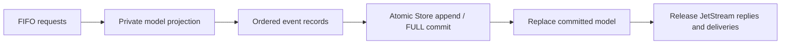

# Durable group commits

In the default mode, synchronous publications, Fetch(1) and ACK requests can share a SQLite FULL
transaction across streams and consumers. Only already queued work joins a group;
there is no assembly timer or client extension. Requests arriving while the private
projection is being processed can join before its commit. Collection remains FIFO:
a read/catalog fence or the 32-request/1 MiB limit ends admission to that group. Pending pulls and interested push
consumers can join the changes that make delivery eligible.

## Isolation and durability

Each GroupPlan has independent logical state, an engine-instance identity and a
base log position. Later members see earlier members' sequence numbers, dedup entries,
ACKs, retention effects and pending limits. Rejected conditional publications do not
consume sequence numbers. Stale, foreign or internally failed plans cannot replace
the committed model. Reads and catalog changes fence groups.

Growing message, subject, deduplication, interest and consumer pending/history/initial
indexes use persistent ordered trees. Cloning a projection shares unchanged nodes;
mutations copy shared tree paths. Small stream/consumer catalogs and configuration
still clone. Immutable Bytes bodies remain shared. Abandoned or failed projections
cannot mutate committed or sibling state. Individual transitions can still scan
indexes, and large catalogs remain a possible cost.

Store appends ordered records and the final high-water position in one transaction.
Only after FULL commit succeeds does Engine publish the projection and release
staged JetStream replies, delivery reservations and ACK confirmations. Unknown write
outcomes poison the engine; no speculative success is exposed before recovery.
Checkpoints serialize the live model and reclaim covered events atomically.
Automatic checkpoints trigger after 8,192 records or 8 MiB of encoded event bytes;
a final group can cross a threshold. Replay restores both counters. This bounds
recovery work while amortizing snapshot serialization and WAL restart costs. The
append is fully durable before checkpointing, so the interval affects replay work
and retained log size, not which confirmed operations survive a crash.

Live Core routing runs separately, before storage admission/completion. Core messages
can be observed even if their JetStream writes later fail or disappear after a crash.
Core is never forwarded a second time on durable completion. PONG and Core +OK do
not provide a disk fence.

## Bounds and accounting

A group gathers at most 32 queued requests and 1 MiB of input. Large requests or
object names use the individual path. Staged output shares channel capacity and an
8 MiB soft byte budget that a final message can exceed. Internal projections cap
encoded records at 8192 / 32 MiB. These are work bounds, not a retained-data quota.

Output count and bytes are tracked incrementally. Counters reset on success and
failure, and the drained effect vector is reused. Request and record vectors reserve
the normal group size. Queued work and completion collection retain a shared global
256-request admission budget, including cancelled/disconnected callers whose work
is still queued. Overflow or a failed/timed-out completion closes the affected
publisher. A lone request retains its individual fast path where applicable.

## Validation

Model properties refine grouped transitions against serial execution, check sibling
projection isolation and exercise checkpoint recovery. Store tests cover atomic batches,
position fencing and ambiguous failure. Process schedules gate mixed groups, inject
I/O failures, kill the server at commit/output boundaries and verify committed prefixes.
Populated-tree cases check untouched streams, dedup entries and pending ACKs. Guest
VM kills check acknowledged state after guest page-cache loss. See [testing](testing.md).

Consumer ACK floors use ordered pending/exhausted minima. First-attempt ACKs remove
their history key directly; redeliveries retain the original key and use the history
lookup path. Retention cleanup skips sequences already finished by the ACK. Recovery
validates that history covers each pending/exhausted sequence exactly once and that
first-attempt tokens identify the corresponding history entry. These changes leave
event records, commit boundaries and checkpoint encoding unchanged.

After a maintenance pass makes delivery progress, the worker polls ingress immediately
and services the next bounded chunk. A pass with no progress uses its idle wait, so
ready pull/push backlogs avoid timer gaps while blocked/empty consumers do not spin.

With `--unsafe-ack-durability`, consumer-only groups can replace their model and
release replies while their records remain in the bounded storage buffer. Groups
containing publications or catalog changes still commit FULL and include the older
buffered prefix. Periodic flush and shutdown use the same FULL transaction path.
